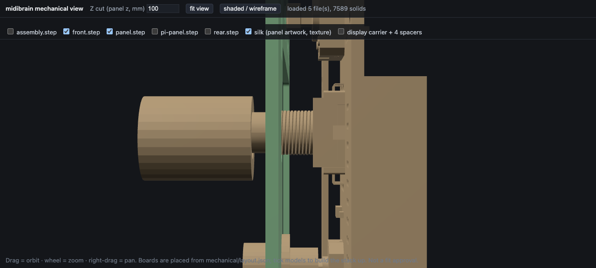
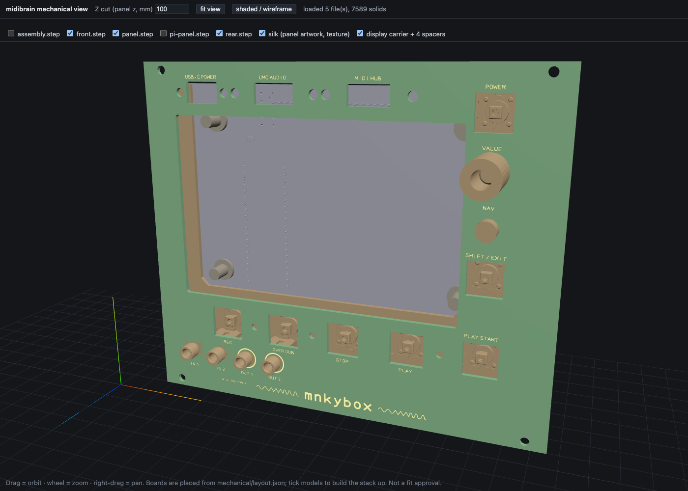

# Mechanical STEP viewer

A local web page that renders the midibrain mechanical STEP models, so the
panel/board/display stack can be looked at without FreeCAD.

```bash
make mechanical-steps           # export every board + the stack as real STEP
make mechanical-view            # installs deps once, serves :8161, opens the browser
make mechanical-view PORT=9000  # another port
make mechanical-view NOOPEN=1   # serve only
```

`make mechanical-steps` runs `tsci export -f step` for each board circuit and
writes the results into `mechanical/viewer/models/` (gitignored - they are 0.03
to 13 MB of generated binary each). It also exports the panel once more as
`-f pcb-svg --layer top` into `mechanical/viewer/panel-silk.svg` (gitignored):
that file is the panel's **silkscreen**, which no STEP can carry - see below.

| model | solids | envelope (mm) | what it is |
| --- | ---: | --- | --- |
| `panel.step` | 1 | 152.0 x 128.5 x 1.6 | the 30HP FR-4 panel, apertures and drills included |
| `front.step` | 85 | 150.0 x 112.0 x 37.7 | front/UI board **with every placed part** in its real Z |
| `rear.step` | 40 | 148.0 x 112.0 x 26.0 | rear/base board with its parts |
| `pi-panel.step` | 1 | 101.2 x 128.5 x 1.6 | the 20HP Pi mounting panel |
| `assembly.step` | 95 | 152.0 x 128.5 x 43.1 | the whole stack: front board at the Z = 0 anchor, panel and rear board as envelopes, plus the seven printed B3F button caps (88 + 7) |

These are tscircuit's own board export, so the parts are the real footprints at
the real heights.

### The scene frame (and why the view used to read mirrored)

Panel coordinates are millimetres with x right, y up and **z rearward** (into
the rack, away from the operator). That frame is **left-handed** against a
viewer whose +z points at you, so loading x/y/z straight into three.js draws a
front-face layout mirrored when you stand anywhere behind it - and it put the
stack along scene Y with the panel at the bottom, i.e. the default camera sat
behind the rear board.

The viewer converts the frame instead (see `toScene()` in `main.js`):

| scene axis | panel axis | result |
| --- | --- | --- |
| +X | +x | screen-right is +x, the operator's right |
| +Y | +y | screen-up is +y |
| +Z | -z | the panel front face is at **scene z 0**, the stack recedes to negative z, so a camera on +z sees the panel face |

That is the orientation tscircuit's 3D view draws, by construction rather than
by picking a camera. `fitCamera()` stands on +z (`+0.55/+0.42/+1.45 x radius`,
~1.6 radii out, which is what holds a 152 x 128.5 mm panel in a 40 degree field)
with `camera.up = +y`, and the grid and axes sit 70 mm below the panel centre so
they never draw over its face. The **Z cut** is a `Plane((0,0,1), cut)`, i.e.
scene z >= -cut, so it still peels the stack along the viewing direction.

### How the models are placed

`serve_manifest.py` writes the placement, so nothing is eyeballed:

- Each board's STEP comes out in **its own frame**: x/y are panel-aligned, but z
  is measured from that board's mid-plane with +z pointing out of its
  panel-facing side - the opposite of the panel frame's z. Loaded at their own
  origins they piled up on each other - that is what the viewer used to do.
- So each model carries `scaleZ = -1` (undo `toScene()`'s z flip, so the
  panel-facing side lands on +scene z) and `positionZ = -(T + 0.8)`, where `T`
  is that board's face nearest the panel, straight out of
  `mechanical/layout.json` `provisionalZ` (panel front 0, +z rearward). Result
  in panel z: panel 0.00…1.60, front board 10.60…12.20, rear board 23.40…25.00,
  each board's parts side facing the panel. In scene z that is panel 0…-1.60,
  front -10.60…-12.20, rear -23.40…-25.00: the panel is nearest the camera and
  the rear board furthest away.
- The vendor display (Waveshare) is in its **own** frame and its STEP also
  carries non-solid construction geometry (raw points reach x = 106 where the
  solid envelope is 106.1 wide), so it cannot be placed by centre arithmetic.
  The viewer aligns it on the **loaded** bounding box, centred on
  `display.x/y`. Which side is the screen is not guessed - it is read off the
  STEP's own products through OpenCascade: `BOARD` sits at z -3.34…-1.74 and the
  SMTSO bosses at -7.34…-1.84, while the IPS/touch panel reaches +4.8, so +z is
  the screen and z is inverted.
- **Scene z is negative rearward** (scene z = -panel z), so the selected glass
  datum **panel z +0.60** is **scene z -0.60**, not +0.60.
- The bbox front of the **verified** vendor STEP is **not** the glass: its
  touch/frame plane stands **1.90 mm in front of the glass face** (verified model
  planes: glass z 2.900, touch/frame z 4.800), so with the glass at panel z 0.60
  the frame front is at **panel z -1.30**, i.e. **scene z +1.30** and 1.30 mm
  proud of the panel front. `serve_manifest.py` imports that 1.90 mm offset from
  `step_geometry.VENDOR_DISPLAY_MODEL` - it is never retyped - and applies it
  **only** when the STEP on disk hashes to the SHA-256 recorded in
  `mechanical/reference/waveshare-4.3inch-dsi-lcd.source.json`. For any other
  STEP the offset is not applied, `align.modelVerified` is false and the page
  says the glass plane is unproven. A model in a viewer is never a fit.
- **XY orientation:** the vendor frame's +x runs opposite the layout's +x, and the
  placement corrects that mirror. The in-plane rotation (**180° about Y**) is the
  drawn **candidate only** - `DISPLAY_ORIENTATION` records both axes and the
  physical orientation of the delivered module is **pending** a labelled front/
  rear photograph.
- The **printed parts** come from two places, and both are inside the stack.
  The NAV keytop and the value knob are `assembly.printedpart` envelopes in the
  front board's own circuit (`front.circuit.tsx`), so they travel inside
  `front.step` and stand on the panel's front side there: `front.step` reaches
  scene z +18.70 (the knob's front face, panel z -18.70) and +4.00 (the keytop,
  panel z -4.00), i.e. in FRONT of the panel face at scene z 0. The seven
  **printed B3F-4055 button caps** do not belong to a board; they are added to
  `tscircuit/assembly.circuit.tsx` and appear in `assembly.step` (88 → **95**
  `MANIFOLD_SOLID_BREP` entities, +7). Because that export is the hidden
  duplicate view of the stack, the manifest lists the cap's own STEP
  (`mechanical/printed/button-cap.step`) once per panel opening and places it
  from `mechanical/layout.json`: x/y are the seven `* BUTTON` apertures and z is
  left alone, because button-cap.step is built on the panel frame already
  (`button_cap.py`; plate z -0.80…3.90, so 0.80 mm proud of the panel front and
  not sunk below it). `assets/viewer-printed-parts.png` is that view. The viewer
  draws STEP files: it proves where the parts are modelled, nothing about the
  printed fit.
- The **display carrier and its four spacers** are drawn as a placeholder from
  `displayStandoff.spacerLength` between the module's rear plane and the rear
  board's front face, at the module's `displayBossPattern`. They stand along
  scene Z in that 8.75 mm gap (panel z 14.65…23.40, scene z -14.65…-23.40):
  behind the module and in front of the rear board's own face, which is where the
  spacers are documented to bolt. There is no STEP for the carrier yet
  (`display_boss_pattern` is open); the spacer and pad diameters are named
  placeholders, so read this as "where it bolts", not as a part.

### The encoder's STEP datum (a viewer workaround, not a model fix)

`front.step` draws U6 (Bourns PEC11R-4015F-S0024, C143789) **4.50 mm too low**.
The cause is in the vendor CAD, not in the placement: the vendor STEP puts the
body's **seating plane** - the large down-facing face spanning its 12.5 mm body,
i.e. the face that stands on the board - at model-local z **-4.50** instead of
on z 0. (The -4.70 planes beside the terminals and the lugs that reach -8.20 are
the terminal shoulders and the mounting lugs, not the seat.) tscircuit's STEP
exporter (`WXo()` in `@tscircuit/cli`'s `dist/lib/index.js`) drops
`model_origin_position` and places every part from `cad_component.position`
alone, so no `modelOriginPosition.z` in
`tscircuit/imports/PEC11R_4015F_S0024.tsx` can move the exported file. Its 3D
view reads the same part through the OBJ importer and looks right, so the import
keeps the vendor value and the viewer compensates.

`main.js` (`correctEncoderDatum()`) finds the part by **defect signature**, not
by name or coordinate. Nothing here demonstrates the encoder's physical fit: the
viewer draws vendor models and asserts mesh positions. In each loaded board model it locates the board plate
(the flat body covering the most area) and takes a mesh that

- reaches more than **4 mm behind** the board's far face (`min.z < bottom - 4`), and
- reaches more than **8 mm in front** of the board's top face (`max.z > top + 8`)

as the encoder. Exactly one mesh matches in `front.step` and in `assembly.step`;
none matches in `panel.step`, `pi-panel.step` or `rear.step`. That mesh is
lifted **+4.50 mm** in scene z, and the viewer then asserts the result, logging
every number to the console:

| check | measured on front.step |
| --- | --- |
| seating face on the board's top face (±0.05 mm) | largest face turned toward the board, 128.8 mm², at scene z -10.60: delta **0.000 mm** |
| shaft/bushing toward the panel (+scene z) | bbox top +16.90, i.e. **27.50 mm** above the board's top face in the drawn model - see the shaft-height conflict below; this is NOT a part dimension |
| legs through the board | bbox bottom -14.30, i.e. **2.10 mm** behind the board's far face |

Before the shift the same mesh ran scene z -18.80…+12.40, which puts the seat at
-15.10, i.e. 4.50 mm below the board's top face.

It **self-heals**: if the export is fixed upstream, or a re-datumed STEP is
vendored, the signature stops matching and nothing is shifted. A missing
signature is **not** proof that the model is correct - it only means this viewer
cannot identify the encoder in that file - so the console says just that:
`no mesh matches the defect signature (0 of 1) - no shift applied; this neither
confirms nor clears the encoder model`. If more than one mesh matches, the
viewer refuses to guess: no shift, a visible warning on the page
(`ENCODER IDENTITY AMBIGUOUS`) and the same in the status line. If no seating
face can be found after the shift, the guard FAILS visibly instead of throwing.
A model that carries no encoder at all (the panel, the Pi panel, the rear board)
is reported as `not-applicable`, not as a failure - there is nothing to correct
in it. The correction is REFUSED outright when `models.json` does not identify a
board in the file, so the reference/vendor STEP and any unlabelled export are
never shifted by this heuristic. If the post-shift guard fails, or no seating
face can be found, the mesh is put back exactly as exported: a shift that cannot
be checked is not left in the scene. Every warning stays visible in the HUD (not
in the board list, which `renderToggles()` clears) and the status line names
each refused board match.

The board plate is checked against the board's documented footprint before any
shift (`board` in `models.json`): the largest 1.2-2.0 mm plate in a model is not
necessarily its board - the assembly export also carries the panel - so a plate
that does not match the documented size is refused and the page says so.

The results are on the page as `window.__viewer.encoders`. **Remove the
workaround only when the exporter honours `model_origin_position` or
`front.step` is re-datumed** - it is not a model fix, and it must not be turned
into an unconditional offset.

### Shaft height: the model and the drawing disagree (UNRESOLVED)

The vendor L15 dimension runs from the **6.5 mm shoulder** and includes the
**LB 5.0 mm** body, so the vendor's nominal shaft tip is **21.50 mm** above the
PCB top. The STEP mesh, after the workaround, reaches **27.50 mm** above the
board - a **6.00 mm** difference. It is a property of this model, not a part
measurement: no encoder has been calipered, so the viewer shows both numbers,
prints `UNRESOLVED` beside them, and makes **no physical-fit claim whatsoever**.
A guard that passes says only that the shifted mesh sits where the arithmetic
expects; it says nothing about the part. See `encoder_solder_process` and
`case_fit` in `docs/acceptance.md`, both pending.



Profile from +x with the panel edge-on, after the workaround: left to right are
the printed knob envelope (opaque in the STEP viewer, translucent in
tscircuit's 3D view), the shaft, the panel's edge and the M7 bushing standing
through its VALUE aperture, then the encoder body in the 9 mm gap above the
front board. The 4.50 mm the workaround restores is exactly that gap between
the body's seating face and the board's top face (scene z -15.10 → -10.60); the
legs, on the far face, are 2.10 mm short of the bbox and are asserted
numerically rather than drawn in this view.

### Panel silkscreen (a texture, not geometry)

A STEP carries surfaces, so `panel.step` has the outline and every aperture but
no wordmark and no legends. `make mechanical-steps` therefore exports the panel
one more time, as `-f pcb-svg --layer top` (the same `tsci export` format
`tscircuit/scripts/render_boards.ts` uses for the board renders), and the viewer
maps that artwork onto the panel front face as a **texture**:

- The SVG is cropped to the board outline it carries itself, and only the
  `pcb_silkscreen_*` marks are kept. The board edge, the cutouts and the drill
  hits are dropped: the STEP already has those as real holes, and they are not
  ink.
- It is rasterised in the browser (SVG -> `` -> `canvas` at 12 px/mm, i.e.
  2.6x the exported 800 x 600 drawing) into a `THREE.CanvasTexture` on a
  `PlaneGeometry` sized to the panel (152 x 128.5 mm), with `transparent: true`,
  `depthWrite: false`, and 0.05 mm **in front of** the panel face (scene z 0).
  It neither z-fights the FR-4 nor hides the apertures.
- The exported SVG embeds the TscircuitAlphabet font it draws with as a data
  URL, so the raster keeps the drawn glyphs rather than a fallback face.
- Silk is a texture and not extruded geometry **on purpose**: JLCPCB prints it as
  flat ink on the board surface. Extruding it would add solids at a height the
  panel does not have, i.e. it would draw a part that is not there and could be
  mistaken for a clearance.
- The **silk** toggle in the model bar shows and hides it (default on). If the
  SVG is missing, the stack still loads and the bar says `silk: none loaded (make
  mechanical-steps)`: a missing texture must not blank the mechanical model.



The default camera (+z, see above): the mnkybox wordmark and its waves, REC /
OVER DUB / STOP / PLAY, PLAY START, IN 1 / IN 2 / OUT 1 / OUT 2 (with the bold
OUT rings), MIDI TRS TYPE A, VALUE, NAV, SHIFT/EXIT, POWER and the three USB
legends all read the way they will on the fabricated panel. Every mark is the
panel's own exported silk, so these are the fabrication positions, not a redraw.

### The Z cut

`Z cut (panel z, mm)` peels the stack at that panel z: everything with
`panel z <= cut` (scene z >= -cut) is kept. It starts at 100 (above the whole
stack, so it looks off) and clips along the viewing direction, so dragging it
down removes the panel first, then the boards.

The old `STACK_MM` placeholder boxes are gone: they were a sketch of the
**pre-respin** stack (128 mm board at z 17.45) and duplicated real geometry. They are
still a viewing aid, not a fit approval: tscircuit derives component Z from its
own CAD models, and a vendor model with a wrong origin shows up as a wrong
height here.

Stop it with Ctrl-C. `serve.sh` regenerates `models.json` on every start (it is
gitignored) and lists every STEP it finds under:

- `mechanical/reference/*.step` — vendor reference models (Waveshare display)
- `mechanical/cad-out/*.step` — the composed assembly, if you ran `make mechanical-cad`
- `mechanical/viewer/models/` — anything you drop here

## Why this exists and what it is not

tscircuit's 3D view only draws parts that belong to a **board circuit**, and its
`cadModel` takes a URL. The panel, the display and the composed assembly are not
board parts, so they never appear there. This viewer reads the actual STEP files
with OpenCascade (`occt-import-js`) and `three.js`, offline after one
`npm install`.

It is a **viewing aid, not a fit approval**. The models are vendor CAD or
generated placeholders. No dimension here is a measurement of a delivered part.

## Controls

| Control | What it does |
| --- | --- |
| drag / wheel / right-drag | orbit / zoom / pan |
| **Z cut (mm)** | clips everything beyond that panel z; drag it down to slice the stack from the panel rearward |
| **fit view** | re-fit the camera to the loaded meshes |
| **shaded / wireframe** | toggle |
| **silk** (model bar) | show/hide the panel silkscreen texture, on by default |
| **show stack boxes** | overlay the documented stack as translucent boxes |

## The stack overlay

Boxes for the parts with no STEP, using the heights in
`tscircuit/lib/layout.ts` (`PROVISIONAL_Z`) and the jack STEP bounding boxes:

| Box | Size (x × y × z, mm) | z0 (panel front = 0) | Source |
| --- | --- | --- | --- |
| panel | 152.0 × 128.5 × 1.6 | 0.00 | `PANEL` (30HP, 152.0 actual) |
| front board | 150.0 × 112.0 × 1.6 | 10.60 | `FRONT_PCB`, `PROVISIONAL_Z.frontBoardTop` |
| rear board | 148.0 × 112.0 × 1.6 | 23.40 | `REAR_PCB`, `PROVISIONAL_Z.rearBoardFront` |
| stereo jack (×4) | 10.0 × 12.73 × 15.5 | 0.00 | PJ366ST STEP bounding box |
| button + cap (×7) | 12.0 × 12.0 × 10.0 | 0.00 | Omron reference: **10.0 ±0.4 mm PCB top → CAP TOP** (so a bought cap top would sit 0.60 mm BEHIND the 10.6 mm panel front, nominally; its installed position is unverified). The printed cap is 4.70 tall, top 11.40 above the board |

(The 128 mm / 17.45 mm figures that used to be here were the pre-respin stack;
`mechanical-steps` above is the accurate route now that the boards export.)

Positions are the connector/button XY from `lib/layout.ts` at the time of
writing; if the layout moves, these do too — update them here or read them from
`mechanical/layout.json`.

## Two things the models themselves told us

1. **The Waveshare display STEP loads as 394 solids, bounding box
   106.1 × 68.363 × 13.820 mm** — which matches
   `mechanical/reference/waveshare-4.3inch-dsi-lcd.source.json` exactly, so the
   file is the model that source record describes.
2. **Its own axes are canvas-flat**: X = 106.1 (width), Y = 68.36 (height),
   Z = 13.82 (thickness). The viewer draws it in that vendor orientation at the
   origin — it is **not** stood up against the panel here. Standing it up and
   giving it a z is what `mechanical/step_assembly.py` does; use the composed
   assembly from `make mechanical-cad` for the real placement.

## Licensing

The vendor STEP is **not committed** (`midibrain/.gitignore` has `*.step`); only
`mechanical/reference/*.source.json` is tracked, with URL, retrieval date and
SHA-256 so the file can be re-fetched. Do not commit vendor CAD here without
checking its redistribution terms.
